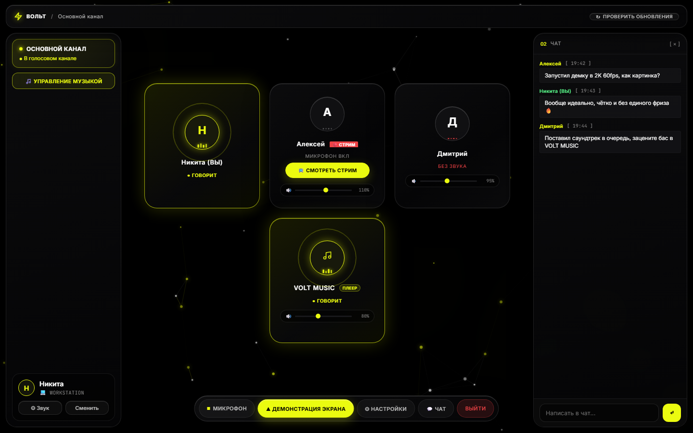
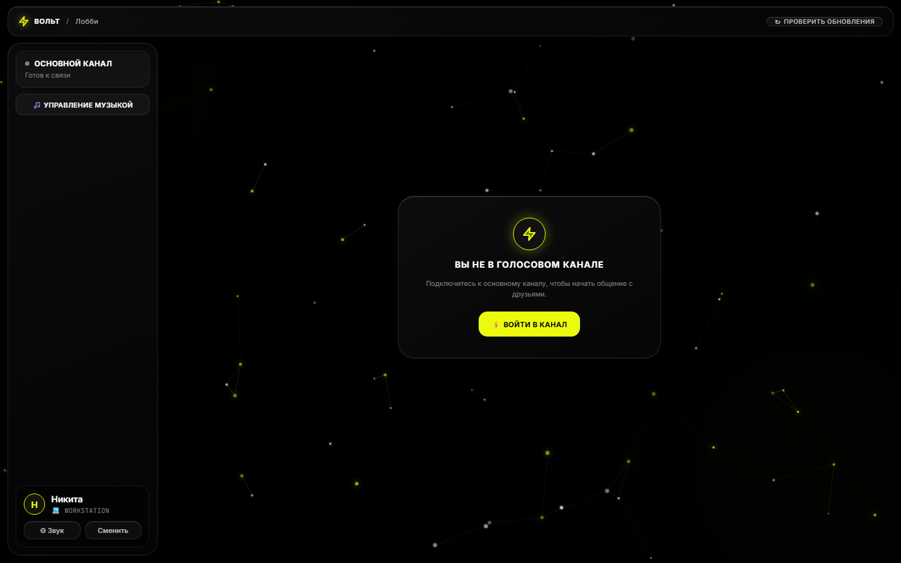
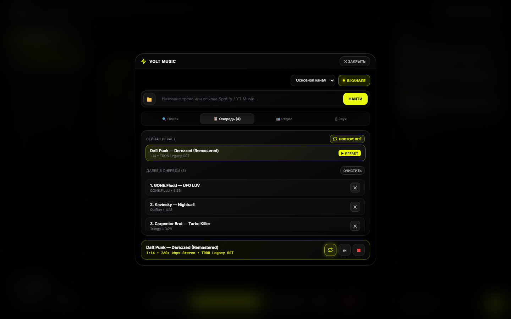
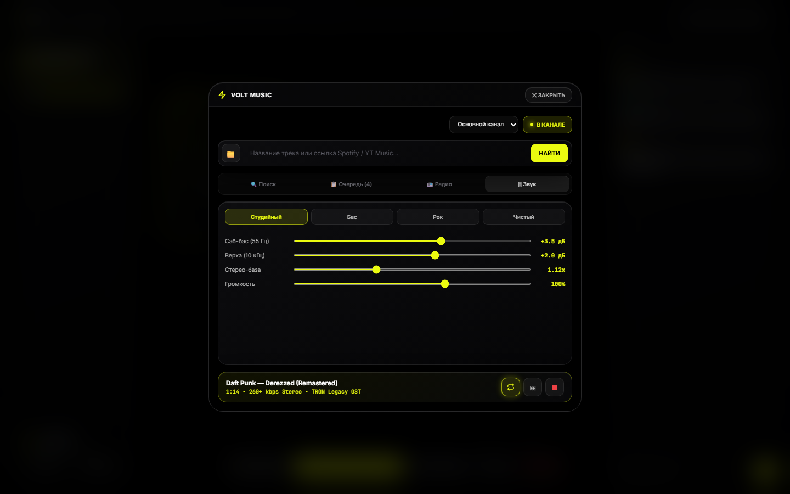
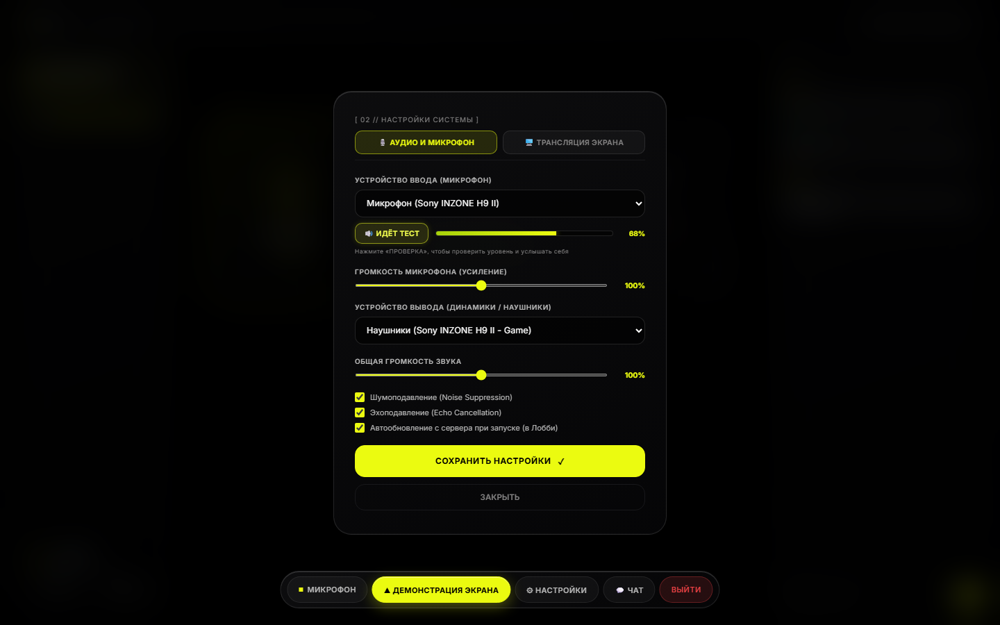
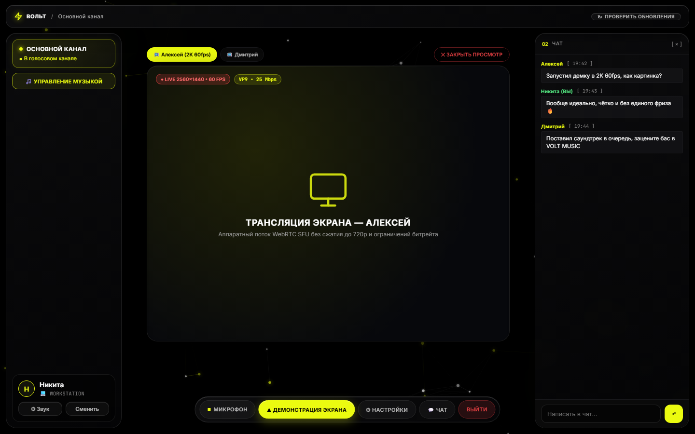

# ⚡ VOLT — Self-Hosted голосовой мессенджер с 2K 60fps стримами и Hi-Fi плеером

Лёгкий, приватный self-hosted аналог Discord для общения небольшой компании (3–6 человек), построенный на **LiveKit SFU**, **Python**, **FFmpeg (`libsoxr`)** и нативном десктоп-клиенте на **Rust (`tao` + `wry`)**.

Спроектирован так, чтобы стабильно работать даже на недорогом VPS (2 vCPU / 2 GB RAM), выдавать **2K 60fps** демонстрацию экрана без искусственных лимитов битрейта и не обрываться при сворачивании в фоне во время игр.

---

## 📸 Интерфейс (Dark Liquid Glass)

### Голосовой канал, живой чат и встроенный Hi-Fi плеер


### Лобби и привязка сессии к железу


### Встроенный плеер VOLT MUSIC (Очередь, зацикливание, студийный EQ)
| Очередь и управление повтором | Студийный эквалайзер (`libsoxr 28-bit`) |
| :---: | :---: |
|  |  |

### Настройки микрофона (тест и усиление 0–200%) и 2K 60fps стрим
| Аудио, тест микрофона и громкость | Мульти-стрим 2560×1440 • 60 FPS |
| :---: | :---: |
|  |  |

---

## ✨ Ключевые возможности

* **Голос и 2K 60fps демонстрация экрана без ограничений:**
  * Передача видео до `2560×1440 @ 60fps` (`VP9`, `25 Mbps`) через WebRTC SFU (LiveKit).
  * Переключение между несколькими одновременными стримами прямо внутри окна без принудительного перекидывания зрителей.
  * Индивидуальная регулировка громкости каждого участника (`0–200%`), тест микрофона с прослушиванием себя в реальном времени и усиление микрофона до `200%`.
* **Встроенный студийный музыкальный плеер (`VOLT MUSIC` в `music-bot/`):**
  * Аудиопоток `48 kHz Stereo Opus` (`260+ kbps`, `DTX=off`, `RED=off`) с точной синхронизацией пакетов каждые `20.0 мс`.
  * Мастеринг-цепочка на `FFmpeg` + `libsoxr` (28-bit precision), лимитер, стереорасширение и 4 пресета эквалайзера (*Студийный*, *Бас*, *Рок*, *Чистый*).
  * Поддержка поиска, прямых ссылок (**Spotify, YouTube Music, YouTube, SoundCloud, Apple Music, Яндекс Музыка**), загрузки локальных аудиофайлов (`FLAC / MP3 / WAV / OGG / M4A`), встроенного радио и зацикливания (`Выкл / Плейлист / Один трек`).
  * Автоматический выход из пустого канала через 5 минут отсутствия людей.
* **Нативный Windows-клиент на Rust (`VOLT.exe` < 1 МБ):**
  * Написан на `tao` + `wry` (`Edge WebView2`) с кастомной иконкой и вшитым автообновлением с сервера (проверка `SHA-256`, прогресс-бар `0–100%`, бесшовная подмена и перезапуск).
  * **Аппаратная привязка сессии:** вычисляет криптографический `HWID` на базе Windows `MachineGuid` — никаких фантомных дубликатов при переподключении и защита имени владельца на сервере.
  * **Защита от фризов в играх:** принудительно отключает фоновый троттлинг таймеров и occlusion в `WebView2`, чтобы голосовой сокет не засыпал, когда приложение свёрнуто за полноэкранной игрой.
* **Сетевая устойчивость:**
  * Встроенный сервис защиты ядра (`deploy/volt-dpishield.service`) отсекает фейковые `badseq` (`seq+10000`) пакеты DPI-обходов на TCP-порту 443, предотвращая повреждение SACK-буфера при отправке крупных WebRTC SDP-офферов.

---

## 🏗 Архитектура и структура проекта

```text
volt-voice/
├── docker-compose.yml          # Единый стек: LiveKit + Caddy + volt-app + volt-bot
├── .env.example                # Шаблон переменных окружения и ключей
├── server/                     # Веб-бэкенд, JWT-токены LiveKit, отдача статики и прокси плеера
│   ├── app.py
│   ├── Dockerfile
│   └── static/
│       ├── index.html          # Основной клиент (Dark Liquid Glass, WebRTC, чат, тест микрофона)
│       ├── music.html          # Встроенный пульт VOLT MUSIC
│       ├── livekit-client.umd.min.js
│       └── anime.min.js
├── music-bot/                  # Независимый Hi-Fi аудио-сервис VOLT MUSIC (Python + FFmpeg + yt-dlp)
│   ├── bot.py
│   ├── requirements.txt
│   └── Dockerfile
├── desktop/
│   └── volt_desktop/           # Нативный Windows-клиент на Rust (Wry / Tao / Self-Updater / HWID)
│       ├── Cargo.toml
│       ├── build.rs
│       ├── icon.ico
│       └── src/main.rs
├── deploy/                     # Конфиги прокси, LiveKit и systemd-защиты порта 443
│   ├── Caddyfile
│   ├── livekit.yaml.template
│   └── volt-dpishield.service
└── screenshots/                # Скриншоты интерфейса
```

---

## 🚀 Быстрый запуск сервера (Docker Compose)

1. **Клонируйте репозиторий и подготовьте конфиги:**
   ```bash
   cp .env.example .env
   cp deploy/livekit.yaml.template deploy/livekit.yaml
   ```
2. **Заполните `.env` и `deploy/livekit.yaml`:**
   * Укажите свой домен (`DOMAIN=voice.example.com`) с A-записью на ваш VPS.
   * Сгенерируйте надёжный `LIVEKIT_API_SECRET` (минимум 32 символа) и укажите его одинаково в `.env` и в `deploy/livekit.yaml`.
   * Откройте порты на сервере: `80/tcp`, `443/tcp`, `7881/tcp` и `50000-50100/udp`.
3. **Запустите стек одной командой:**
   ```bash
   docker compose up -d --build
   ```
4. *(Опционально)* Если пользователи подключаются через DPI-обходы с `badseq` (`seq+10000`) на порту 443, активируйте фильтр на хосте:
   ```bash
   sudo cp deploy/volt-dpishield.service /etc/systemd/system/
   sudo systemctl enable --now volt-dpishield
   ```

---

## 🖥 Сборка нативного клиента для Windows (`VOLT.exe`)

Для сборки десктоп-клиента под ваш домен понадобится установленный [Rust](https://rustup.rs/):

```powershell
cd desktop/volt_desktop
$env:VOLT_SERVER_URL = "https://voice.example.com"
cargo build --release
```

Готовый исполняемый файл появится в `desktop/volt_desktop/target/release/volt.exe`. При помещении его в `server/static/VOLT.exe` клиенты смогут скачивать его с веб-версии и автоматически обновляться по кнопке в интерфейсе.
